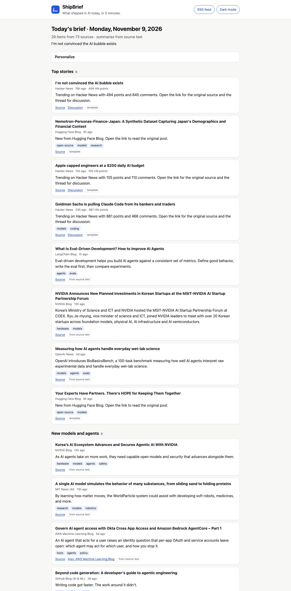
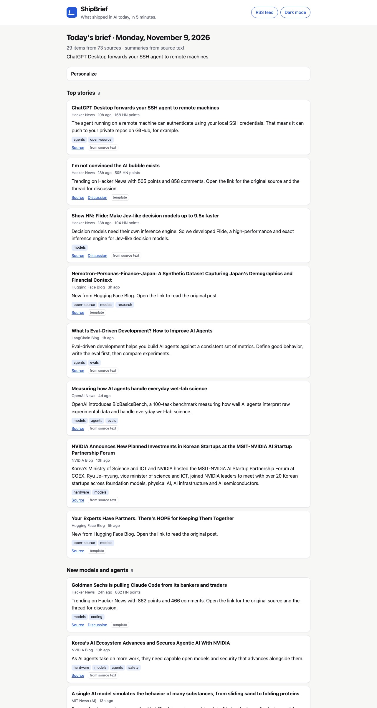
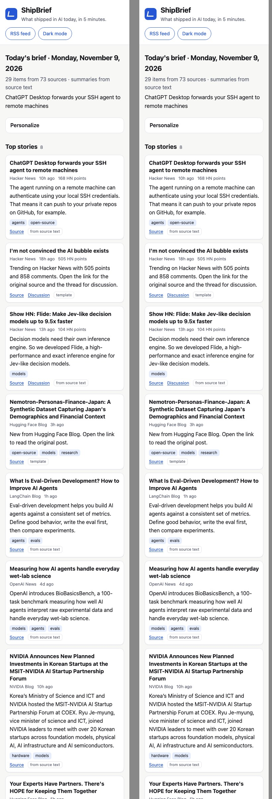

# ShipBrief

**A free, automated 5-minute daily brief of what shipped in AI**: top stories, new models and agents, tools worth trying, open-source releases, a research highlight, one practical prompt, and one workflow to try today.

- Runs daily on **GitHub Actions** and publishes to **GitHub Pages**. Both are free for public repositories.
- **MODE 1 (default, $0):** summaries are extracted from each feed's own text and items are ranked by a transparent formula. No AI model is called.
- **MODE 2 (optional):** add an `ANTHROPIC_API_KEY` repository secret and Claude writes the summaries (`claude-haiku-5-5`) and composes the prompt and workflow (`claude-sonnet-5-5`). A hard per-run budget guard applies (default $0.10/run; typical cost is about $0.01–0.02).
- Outputs:
  - a static web page
  - versioned JSON (`data/latest.json`, `data/YYYY-MM-DD.json`, `data/index.json`)
  - an Atom feed (`feed.xml`)
  - run diagnostics (`data/health.json`)

| Light | Dark | Mobile |
|---|---|---|
|  |  |  |

New here (human or AI)? Read **[HANDOFF.md](HANDOFF.md)** first. The data contract is in **[docs/SCHEMA.md](docs/SCHEMA.md)**, and the reasoning behind every choice is in **[DECISIONS.md](DECISIONS.md)**.

---

## Architecture

```
sources.yaml ─┐
              ▼
 ┌──────────── shipbrief/ (Python 3.12, stdlib + PyYAML + jsonschema [+ anthropic in MODE 2]) ───────────┐
 │ 1 FETCH      fetch/runner.py   parallel, per-source timeout + retries + robots.txt (http.py)           │
 │              fetch/parsers.py  RSS 2.0 / Atom / RDF / arXiv / GitHub releases.atom / HN Algolia JSON  │
 │ 2 NORMALIZE  normalize.py      one Item schema; drop undated/old/pre-release; HTML stripped (text.py)  │
 │ 3 DEDUPE     dedupe.py         canonical URL merge + title-similarity clustering                      │
 │ 4 FILTER     normalize.filter_relevance + classify.py (AI keywords, tags, kind, roles)                │
 │   HISTORY    history.py        drop items already published in the last 7 days                        │
 │ 5 RANK       ranking.py        ONE documented formula + per-section diversity                         │
 │ 6 SUMMARIZE  summarize/        MODE 1 extractive.py | MODE 2 llm.py + budget.py; factcheck.py guards  │
 │ 7 COMPOSE    compose.py        sections, prompt of the day, try-this-today                            │
 │ 8 VALIDATE   validate.py       JSON Schema (schema/digest.v1.schema.json) + semantic checks           │
 │ 9 PUBLISH    publish.py        data/*.json, index.json, feed.xml, 90-day pruning, health              │
 └───────────────────────────────── orchestrated by pipeline.py, CLI in __main__.py ────────────────────┘
              ▼
 .github/workflows/daily.yml: cron 11:07 UTC → tests → run → commit data/ → keepalive → Pages deploy
              ▼
 site/ (index.html + app.js + style.css) reads data/*.json in the browser. No build step.
```

**Fail-safe rule:** if validation fails, or fewer than 8 candidate items exist, nothing is published. The previous digest stays live, `data/health.json` records why, and the workflow run turns red.

**Safety rule:** all fetched content is untrusted *data*. Every published item's URL and date must match a record fetched in the same run. Model-written text is labeled with `generatedBy` and is rejected (falling back to MODE 1) if it contains numbers, versions, or URLs that aren't in the source text. See DECISIONS.md D22–D23.

---

## Quick start (local)

```bash
git clone https://github.com/<you>/shipbrief.git && cd shipbrief
python3 -m venv .venv && source .venv/bin/activate
pip install -r requirements-dev.txt

python -m pytest -q                  # 71 tests, offline
python -m shipbrief dry-run          # offline run on saved fixtures, no keys; writes out/ and prints the digest
```

Live run (uses the network and writes `data/` and `feed.xml` in the repo):

```bash
# macOS python.org builds lack CA certs; this line is harmless elsewhere:
export SSL_CERT_FILE="$(python -m certifi)"
python -m shipbrief run --print
```

Preview the website:

```bash
python -m shipbrief build-site _site && python -m http.server -d _site 8000
# open http://localhost:8000
```

Other commands:

| Command | What it does |
|---|---|
| `python -m shipbrief validate data/latest.json` | Validate digest files against the schema and semantic rules |
| `python -m shipbrief explain --top 20` | Show the ranking breakdown (why each item scored what it did) using fixtures |
| `python scripts/verify_sources.py` | Fetch every source once and report OK/EMPTY/FAIL |
| `python scripts/verify_sources.py --save-fixtures tests/fixtures/live --trim` | Refresh the offline fixtures |
| `python scripts/quality_report.py` | Write `REVIEW_REPORT.md` for the last 14 days |
| `SHIPBRIEF_MODE=extractive python -m shipbrief run` | Force MODE 1 even if a key is set |

Exit codes of `run`: `0` published, `1` error, `2` validation failed, `3` too few items.

---

## Deploying (one time, about 10 minutes)

You need a GitHub account. Everything below is free.

1. **Create the repository.** On github.com, go to **New repository**, name it `shipbrief`, set it to **Public**, and don't add a README.
2. **Push the code** from this folder:
   ```bash
   git remote add origin https://github.com/<you>/shipbrief.git
   git push -u origin main
   ```
3. **Enable Pages.** Open the repo's **Settings → Pages**, then under **Build and deployment → Source**, select **GitHub Actions**.
4. **Allow the workflow to push.** In **Settings → Actions → General → Workflow permissions**, select **Read and write permissions** and save.
5. **First run.** Open the **Actions** tab. If asked, click **"I understand my workflows, go ahead and enable them"**. Then open **daily-digest → Run workflow**.
6. After about 2 minutes the site is live at `https://<you>.github.io/shipbrief/` and the feed at `https://<you>.github.io/shipbrief/feed.xml`.

From then on it runs every day at about 11:07 UTC. GitHub can start scheduled runs late, especially at busy times.

### Optional: MODE 2 (Claude summaries)

1. Create an API key at **platform.claude.com** (**Settings → API keys**) and add a few dollars of prepaid credit under **Billing**. $5 lasts months at the default cap.
2. In the repo, open **Settings → Secrets and variables → Actions → New repository secret**. Name it `ANTHROPIC_API_KEY` and paste the key.
3. Run the workflow manually once and check `data/health.json` → `llm` for token usage and estimated cost.
   - To change the cap, edit `SHIPBRIEF_LLM_MAX_COST_USD` in `.github/workflows/daily.yml`.
   - To turn MODE 2 off, delete the secret. MODE 1 resumes automatically.

The key is only ever read by the Anthropic SDK from the environment. It's never written to files, logs, or the web page, and a log filter redacts it if it ever appears.

---

## Adding or removing sources

Edit `sources.yaml`. Each line is one source:

```yaml
- {id: my-lab, name: My Lab Blog, type: rss, url: "https://mylab.example/feed.xml", weight: 1.2, tags: [models], kind: news, roles: [developer]}
- {id: gh-myrepo, name: MyRepo, type: github_releases, repo: owner/myrepo, weight: 0.8, tags: [agents]}
```

- `type` is one of `rss` (also Atom and RDF), `github_releases`, `hn`, or `arxiv`.
- `weight` is 0.1–2.0: the importance in ranking. Official labs are about 1.5–1.8, GitHub repos about 0.6–1.2, arXiv 0.6.
- To remove a source, delete its line or set `enabled: false`, which keeps it documented.
- General-purpose feeds must pass the AI-keyword filter. AI-only feeds are listed in `AI_NATIVE_SOURCES` in `shipbrief/normalize.py`, so add your id there if the feed is AI-only.
- Then run `python scripts/verify_sources.py` to confirm the source fetches, parses, and is allowed by robots.txt.

Rules (keep these): only official RSS/Atom feeds or documented public APIs. No scraping of pages, other newsletters, or paywalled content. Respect robots.txt (the fetcher enforces it).

---

## Repository map

```
sources.yaml              the source list (74 configured, 73 enabled, all verified)
shipbrief/                pipeline package (see Architecture)
schema/                   JSON Schemas: digest.v1, index.v1, health.v1
site/                     static web page
data/                     published output (committed by the bot; 90-day archive)
feed.xml                  Atom feed (committed by the bot)
scripts/                  verify_sources.py, quality_report.py
tests/                    pytest suite + fixtures (unit = hand-written, live = trimmed real capture)
docs/                     SCHEMA.md, ACCESSIBILITY.md, samples/, screenshots/
.github/workflows/        daily.yml (scheduled pipeline + Pages), ci.yml (tests on push/PR)
DECISIONS.md PROGRESS.md HANDOFF.md REVIEW_LOG.md REVIEW_REPORT.md
```

## Troubleshooting

| Symptom | Check |
|---|---|
| Red run in Actions | The `::error::` line gives the exit code. `data/health/<date>.json` → `failureReason`. |
| Site shows "this brief is N days old" | Is the workflow disabled? Actions → daily-digest → **Enable workflow**, then **Run workflow**. |
| A source keeps failing | `python scripts/verify_sources.py` and look at the error, then fix the URL or set `enabled: false`. |
| `git push` from the workflow is rejected | Settings → Actions → General → Workflow permissions → Read and write. |
| Pages 404 | Settings → Pages → Source must be **GitHub Actions**. |
| `CERTIFICATE_VERIFY_FAILED` locally | `export SSL_CERT_FILE="$(python -m certifi)"` |

## License and content

The code is yours to license (add a LICENSE file). Published data contains only titles, links, short summaries, and tags. Every item links back to its original source.
